# Agenda de eventos - Ayuntamiento de Santiago-Pontones
 
       


<div style="text-align: center;">
	
</div>

<br>

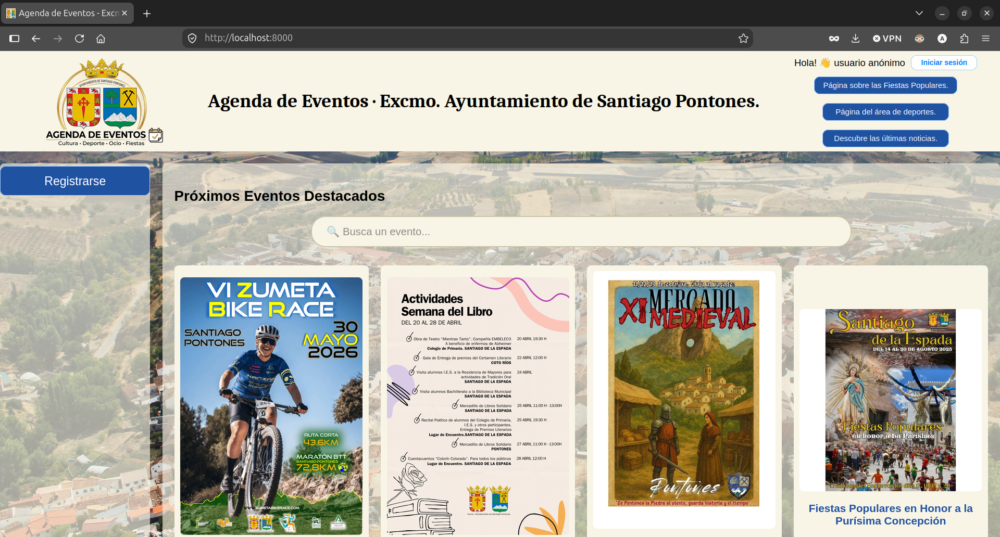

## Índice

- [1. Descripción del proyecto](#1--descripción-del-proyecto)
- [2. Tecnologías utilizadas](#2--tecnologías-utilizadas)
- [3. Arquitectura del sistema](#3--arquitectura-del-sistema)
  - [3.1. Modelo (Acceso a datos)](#31--modelo-acceso-a-datos)
  - [3.2. Vista](#32--vista)
  - [3.3. Controlador](#33--controlador)
- [4. Funcionalidades y sistema de roles](#4--funcionalidades-y-sistema-de-roles)
  - [4.1. Consulta de eventos](#41--consulta-de-eventos)
    - [Diseño responsive](#diseño-responsive)
  - [4.2. Registro, autenticación y perfil de usuario](#42--registro-autenticación-y-perfil-de-usuario)
  - [4.3. Comentarios y moderación](#43--comentarios-y-moderación)
  - [4.4. Gestión de eventos y hashtags](#44--gestión-de-eventos-y-hashtags)
  - [4.5. Gestión de usuarios](#45--gestión-de-usuarios)
  - [4.6. Roles del sistema](#46--roles-del-sistema)
    - [Usuario anónimo](#usuario-anónimo)
    - [Usuario registrado](#usuario-registrado)
    - [Usuario moderador](#usuario-moderador)
    - [Usuario gestor](#usuario-gestor)
    - [Superusuario](#superusuario-o-administrador)
  - [4.7. Demostración de la aplicación en vídeo](#47--demostración-de-la-aplicación-en-vídeo)
- [5. Modelo de datos y seguridad](#5--modelo-de-datos-y-seguridad)
  - [5.1. Modelo de datos](#51--modelo-de-datos)
  - [5.2. Seguridad](#52--seguridad)
- [6. Requisitos, configuración y despliegue (Docker)](#6--requisitos-configuración-y-despliegue-docker)
  - [6.1. Requisitos previos](#61--requisitos-previos)
  - [6.2. Configuración inicial](#62--configuración-inicial)
  - [6.3. Inicio de la aplicación](#63--inicio-de-la-aplicación)
- [7. Guía de uso](#7--guía-de-uso)
  - [7.1. Consulta pública](#71--consulta-pública)
  - [7.2. Gestión de contenidos](#72--gestión-de-contenidos)
- [8. Autoría y licencia](#8--autoría-y-licencia)


## 1.- Descripción del proyecto.

**Agenda de Eventos del Ayuntamiento de Santiago-Pontones** es un portal web para publicar y consultar eventos, actividades culturales, noticias y otros contenidos de interés local.

El proyecto se desarrolló para la asignatura **Sistemas de Información Basados en Web (SIBW)** del grado en Ingeniería Informática durante el curso 2025/2026, en la Universidad de Granada. 

El proyecto fue evolucionando desde una interfaz estática hasta una aplicación web completa con backend propio, base de datos relacional, gestión de contenidos y peticiones asíncronas.

Su objetivo es ofrecer una experiencia de consulta de cara al público, y, al mismo tiempo, un espacio de administración adaptado a los permisos de cada usuario encargado de la gestión de contenidos.

## 2.- Tecnologías utilizadas.

Puesto que se trata de un proyecto académico, el desarrollo se ha realizado sin el uso de frameworks de desarrollo web, con el fin de comprender y aplicar los estándares web nativos y las buenas prácticas de programación. Las tecnologías empleadas son:

- **Frontend:** HTML5 semántico, CSS3 (implementando Flexbox y CSS Grid, y diseño responsive mediante media queries, sin utilizar librerías como *Bootstrap*), y JavaScript vanilla (para la lógica del cliente: manipulación del DOM, validación de formularios mediante expresiones regulares, etc).
- **Backend:** PHP 8.3 ejecutado sobre Apache.
- **Vistas (Renderizado):** Motor de plantillas **Twig** para separar vistas y controladores.
- **Base de datos:** MySQL 8 y PDO con sentencias preparadas.
- **Comunicación asíncrona:** Fetch API y endpoints PHP que responden en JSON.
- **Entorno de despliegue:** Sistema contenerizado con **Docker y Docker Compose** (stack LAMP: Linux, Apache, MySQL, PHP) y configuración de servidor Apache mediante `.htaccess` para URLs amigables.
- **Codificación:** `utf8mb4` con reglas de ordenación en español.

## 3.- Arquitectura del sistema

El proyecto sigue una arquitectura **Modelo-Vista-Controlador (MVC)** desacoplada, garantizando la separación de responsabilidades y la mantenibilidad del código:

### 3.1.- Modelo (Acceso a datos).

- `bd.php` centraliza las consultas a la base de datos MySQL mediante PDO. Impelemnta el patrón de desarrollo de software **Singleton** para garantizar que solo exista una instancia de conexión a la base de datos durante el ciclo de vida de una misma petición HTTP.
- Utiiza *sentencias preparadas* en todas las consultas para prevenir ataques de inyección SQL.

### 3.2.- Vista.

- **Plantillas de Twig** en el directorio `www/templates/`. La interfaz utiliza un sistema de herencia de plantillas con Twig. Existe una plantilla base llamada `padre.html` que define la estructura común de todas las páginas (cabecera, menú lateral, estructura Grid y pie de página). de la cual heredan las demás vsitas específicas.

- **Tratamiento seguro de variables:** Los datos dinámicos obtenidos desde el backend se transmiten a la interfaz mediante atributos `data-*` en etiquetas HTML o mediante JSON seguro, evitando la inyección de código mediante bloques.

### 3.3.- Controlador.

- **Los controladores principales (`index.php`, `eventos.php`, `usuarios.php`):** Procesan las peticiones `GET/POST`, gestionan la lógica de negocio, interactúan con la capa de modelo (`bd.php`) y renderizan la plantilla Twig correspondiente pasándole los parámetros requeridos.

- **Endpoints para peticiones AJAX:** Serían los archivos (`api_*.php`) que procesan las peticiones asíncronas desde el cliente (`HTTP POST/GET`), y devuelven respuestas en formato `JSON`. Estos endpoints permiten la actualización de contenidos sin recargar la página, mejorando la experiencia de usuario. Son utilizados, por ejemplo, en el incio/cierre de sesión, el buscador dinamico de eventos o la gestión de visibilidad de los eventos, entre otras.

Mediante el archivo `.htaccess` en la raíz del servidor Apache, se enmascaran las URLs dinámicas por **direcciones URL amigables** (ej. `/evento/ID` en lugar de `/evento.php?id=ID`), manteniendo la estética y el enrutamiento limpio.

Podemos ver un diagrama de arquitectura del sistema que muestra la relación descrita:

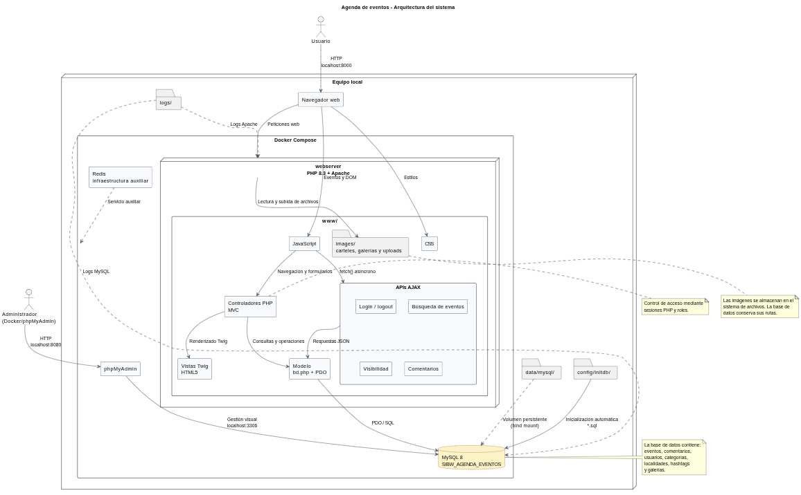

También se puede consultar en el siguiente enlace:
[Diagrama de arquitectura](docs/diseno/diagrama-de-arquitectura.png).

## 4.- Funcionalidades y sistema de roles.

La aplicación permite consultar y gestionar la agenda de eventos del Ayuntamiento de Santiago-Pontones. Su funcionamiento se adapta al tipo de usuario que accede al sistema, dividiéndose en una zona pública para los visitantes y un panel de administración restringido para los usuarios autorizados. 

### 4.1.- Consulta de eventos.

La portada muestra los eventos publicados en forma de tarjetas, incluyendo:

- Título.
- Imagen principal.
- Categoría.
- Localidad.
- Fecha de realización.

*Solo los eventos marcados como publicados aparecen en la portada*.

La portada incluye un **buscador** que permite localizar eventos mientras el usuario escribe. Los resultados se solicitan mediante AJAX y aparecen dinámicamente sin necesidad de recargar la página.

Podemos ver un ejemplo de la **portada de la agenda de eventos**:
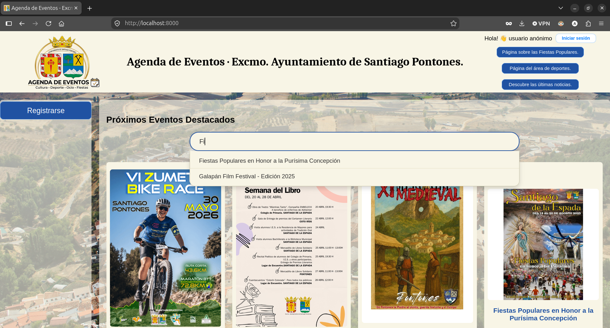

Al seleccionar un evento se accede a una página de detalle de ese evento, donde se muestra: 

- Título, fecha y hora de celebración. 
- Localidad y categoría.
- Descripción completa.
- Hashtags asociados.
- Cartel principal.
- Galería de imágenes.
- Comentarios sobre ese evento.
- Enlaces a redes sociales y a la versión imprimible del evento.

El **panel de comentarios** se despliega pasando el ratón por el borde derecho de la pantalla y permite a los visitantes dejar su opinión sobre el evento, siempre que se encuentren logueados en el sistema.

Podemos ver un ejemplo de la **página de detalle de un evento**:

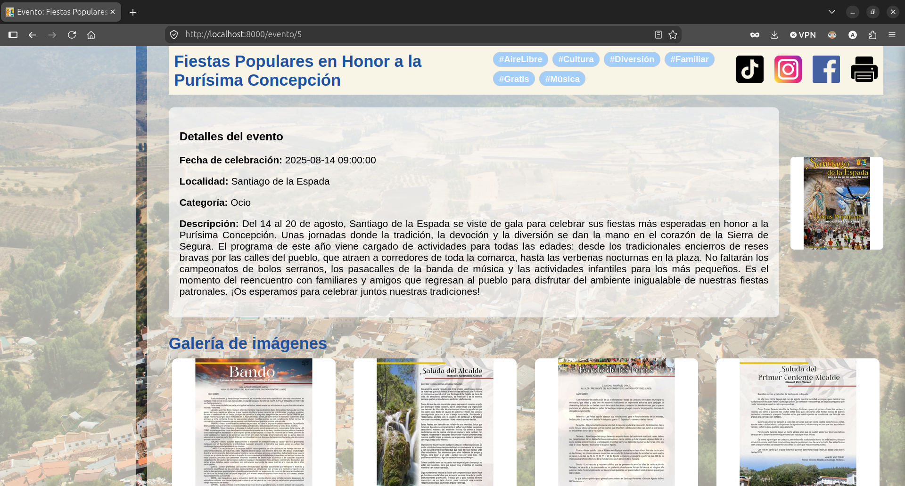

Si pulsamos el botón de la impresora que se muestra en la barra superior de la página del evento, nos mostrará la **versión imprimible del evento**, que utiliza una hoja de estilos específica que adapta el contenido al papel, oculta la navegación y presenta las imágenes en escala de grises.

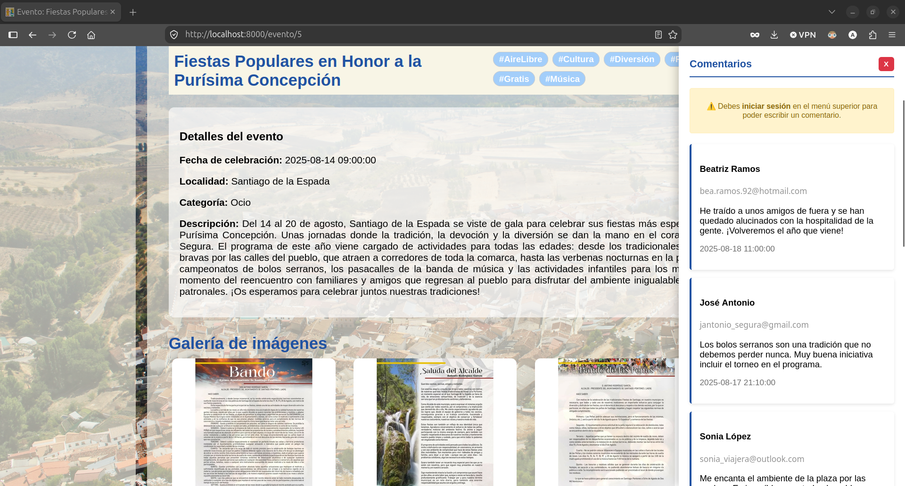

#### Diseño responsive

La aplicación incorpora media queries CSS para adaptar automáticamente la interfaz si la resolución de la pantalla es inferior a 768px. Cuando el ancho de la pantalla disminuye por debajo de ese valor, la distribución de los contenidos, las tarjetas de eventos, la navegación y los elementos del detalle se reorganizan para mantener una experiencia de uso cómoda en dispositivos móviles y tablets, o cuando el usuario redimensiona la ventana del navegador.

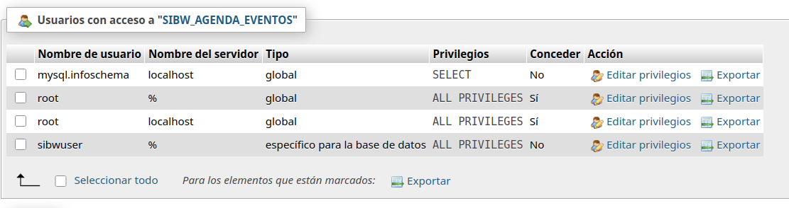


### 4.2.- Registro, autenticación y perfil de usuario.

Los visitantes (o usuarios anónimos) pueden **registrarse** mediante un formulario que valida los campos obligatorios, el formato del correo electrónico, la coincidencia de las contraseñas y la disponibilidad del nick y del correo.

El **inicio de sesión** se realiza desde un formulario modal mediante una petición AJAX. Tras autenticarse, se crea una sesión PHP y la cabecera muestra el nick y el rol del usuario. El cierre de sesión también se realiza mediante AJAX.

Los usuarios autenticados disponen de un **perfil** desde el que pueden modificar su nick, correo electrónico y contraseña. Las contraseñas se almacenan mediante `password_hash()` y se comprueban con `password_verify()`.

### 4.3.- Comentarios y moderación.

Los usuarios registrados pueden añadir comentarios a los eventos, como ya se ha mencionado. El formulario comprueba los campos obligatorios y valida el correo electrónico mediante expresiones regulares. Cada comentario muestra el nombre del autor, el texto y la fecha de publicación.

Los **moderadores y superusuarios(o administradores)** disponen de herramientas para buscar, editar y eliminar comentarios desde un listado global o desde la página del evento. Los comentarios modificados incluyen una marca de edición.

Podemos ver un ejemplo de la gestión de comentarios desde el panel de administración:

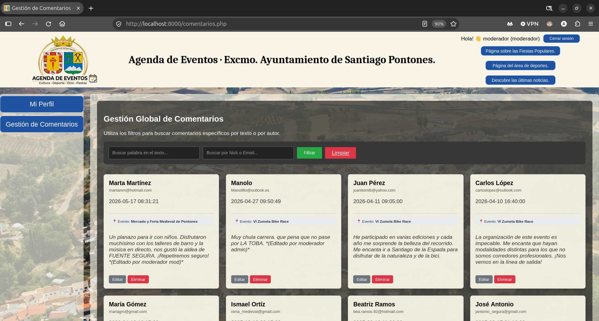


### 4.4.- Gestión de eventos y hashtags

Los gestores y superusuarios disponen de un panel para:

- Crear, editar y eliminar eventos.
- Asignar categorías y localidades.
- Modificar las descripciones.
- Subir carteles y gestionar galerías.
- Asociar hashtags.
- Buscar eventos por título, descripción o hashtag.
- Cambiar el estado de publicación.

El estado publicado/no publicado se actualiza mediante un interruptor y una petición AJAX, sin recargar la página. Los hashtags se gestionan desde una sección propia y pueden asociarse a varios eventos mediante la tabla `eventos_hashtags`.

En la siguiente imagen se muestra la sección de **gestión de eventos**:
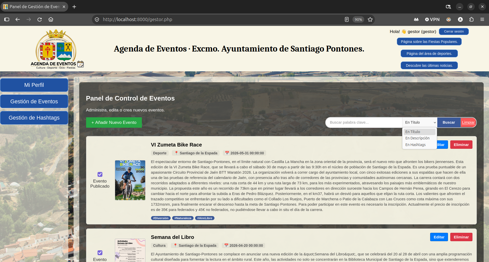

Y una imagen de la sección de **gestión de hashtags**:
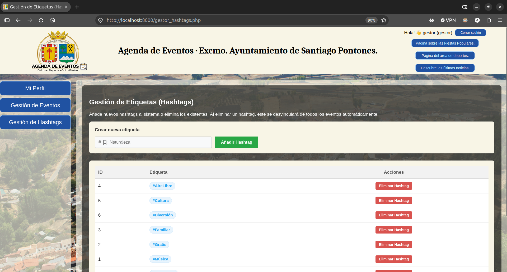


### 4.5.- Gestión de usuarios

El superusuario (o administrador) dispone de un panel con el listado de usuarios registrados. Desde él puede consultar sus datos, modificar usuarios, cambiar roles y eliminarlos. **El sistema impide que se elimine o deje sin protección al último superusuario.**

La siguiente imagen muestra la sección de **gestión de usuarios**:
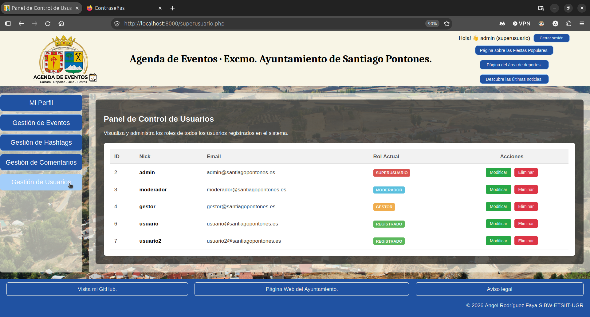


### 4.6.- Roles del sistema

#### Usuario anónimo.

Se entiende por usuario anónimo aquel que no se ha registrado ni ha iniciado sesión en el sistema.

Puede consultar la portada, los eventos publicados con sus detalles, utilizar el buscador de eventos y la versión imprimible. También puede registrarse y acceder a los enlaces externos del Ayuntamiento. No puede comentar ni acceder a las áreas privadas de gestión.

#### Usuario registrado

Se entiende por usuario registrado aquel que se ha dado de alta en el sistema y ha iniciado sesión.

Dispone de todas las opciones del usuario anónimo y, además, puede añadir comentarios, acceder a su perfil, modificar sus datos y cerrar sesión.

#### Usuario moderador

Un usuario se considera moderador si ha sido asignado con el rol de moderador por un superusuario.

Dispone de las opciones del usuario registrado y puede acceder al listado global de comentarios para buscarlos, editarlos o eliminarlos.

#### Usuario gestor

Dispone de las opciones del usuario registrado y puede administrar eventos, imágenes, galerías, hashtags y estados de publicación (si un evento es visible o no de cara al público). También puede buscar eventos por título, descripción o hashtag.

#### Superusuario (o administrador)

Es el usuario con el máximo nivel de permisos.

Dispone de las opciones de moderación y gestión de eventos, además de administrar usuarios y modificar sus roles. La aplicación garantiza que siempre exista al menos un superusuario.

### 4.7.- Demostración de la aplicación en vídeo.

En el siguiente vídeo se puede ver una demostración de la aplicación, mostrando las funcionalidades principales y la experiencia de usuario:


## 5.- Modelo de datos y seguridad

### 5.1.- Modelo de datos

La aplicación utiliza una base de datos relacional MySQL con las siguientes tablas:

- `eventos`: información principal de cada evento y su estado de publicación.
- `categorias` y `localidades`: clasifican y sitúan los eventos.
- `galeria_imagenes`: almacena las imágenes asociadas a cada evento y determina cuál es el cartel principal.
- `hashtags`: etiquetas disponibles para clasificar el contenido.
- `eventos_hashtags`: tabla intermedia que implementa la relación (n:m) entre eventos y hashtags.
- `comentarios`: opiniones asociadas a los eventos.
- `usuarios`: cuentas de acceso, credenciales y roles.

Podemos ver una imagen tomada para ilustrar las tablas creadas en la base de datos:
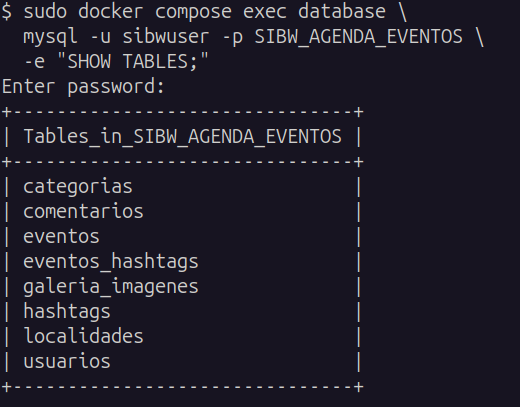


Cada evento pertenece a una categoría y a una localidad, puede tener varias imágenes y puede asociarse a varios hashtags. Los comentarios se relacionan con el evento mediante `evento_id`. En el modelo actual, los comentarios conservan el nombre y el correo introducidos por el autor, pero no tienen una clave foránea hacia `usuarios`.

El esquema y los datos de demostración se encuentran en [`config/initdb/SIBW_AGENDA_EVENTOS.sql`](config/initdb/SIBW_AGENDA_EVENTOS.sql). El diagrama del **modelo entidad/relación** puede consultarse aquí:

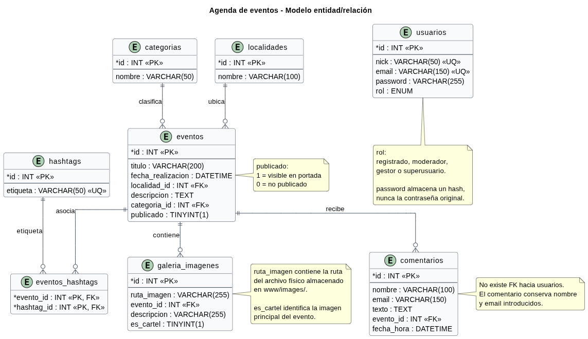

### 5.2.- Seguridad

- Las contraseñas se almacenan mediante `password_hash()` y se comprueban con `password_verify()`. Nunca se guarda la contraseña original.
- El acceso a MySQL se realiza mediante PDO y sentencias preparadas.
- Las funciones privadas se muestran según el rol guardado en la sesión PHP y se validan en el servidor.
- Los formularios comprueban campos obligatorios y formato de correo electrónico tanto en el cliente (en JavaScript) como en el servidor (en PHP).
- **Los datos incluidos en el volcado SQL son ficticios** y se incorporan únicamente para rellenar la base de datos, facilitando la demostración y las pruebas.

## 6.- Requisitos, configuración y despliegue (Docker)

### 6.1.- Requisitos previos

Para ejecutar la aplicación en un entorno local, se requiere:

- Git.
- Docker Engine o Docker Desktop.
- Docker Compose v2 (`docker compose`).
- Puertos disponibles: `8000` para la aplicación y `8080` para phpMyAdmin.

**No es necesario instalar PHP, Apache, MySQL ni Twig en el equipo anfitrión** pues se ejecutan dentro de los contenedores.

### 6.2.- Configuración inicial

Clona el repositorio y accede a su directorio:

```bash
git clone https://github.com/AngelRodriguezFaya/agenda_de_eventos_ayto_santiago-pontones.git
cd agenda_de_eventos_ayto_santiago-pontones
```

Copia la configuración de ejemplo:

```bash
cp sample.env .env
```

**Revisa en `.env` si alguno de los puertos está ocupado.** La configuración incluida utiliza PHP 8.3, MySQL 8, la base de datos `SIBW_AGENDA_EVENTOS`, el usuario `sibwuser` y la contraseña local `sibwpass`.

### 6.3.- Inicio de la aplicación

Construye las imágenes y levanta los servicios:

```bash
docker compose up -d --build
```

La primera vez, MySQL ejecuta automáticamente los archivos SQL de `config/initdb/` cuando inicia con un directorio de datos vacío. La aplicación estará disponible en:

- Aplicación: [http://localhost:8000](http://localhost:8000).
- phpMyAdmin: [http://localhost:8080](http://localhost:8080).

Para consultar el estado de los servicios:

```bash
docker compose ps
```

Para detener los contenedores:

```bash
docker compose down
```

## 7.- Guía de uso

### 7.1.- Consulta pública

1. Abre la portada en `http://localhost:8000`.
2. Utiliza el buscador para localizar un evento.
3. Selecciona una tarjeta para consultar el detalle, la galería, los hashtags y los comentarios.
4. Usa el botón de impresión para abrir la versión preparada para papel.
5. Regístrate o inicia sesión si quieres comentar o acceder al perfil.

### 7.2.- Gestión de contenidos

1. Inicia sesión con una cuenta que tenga permisos de moderación o gestión.
	Podemos utilizar una de las siguientes **cuentas de demostración incluidas en el volcado SQL**:
	- Usuario: `admin`, Contraseña: `administrador` (superusuario).
	- Usuario: `gestor`, Contraseña: `gestor` (gestor de eventos).
	- Usuario: `moderador`, Contraseña: `moderador` (moderador de comentarios).
	- Usuario: `usuario`, Contraseña: `usuario` (usuario registrado).
2. Desde el menú correspondiente, accede a comentarios, eventos, hashtags o usuarios según el rol.
3. En el panel de eventos, crea o edita la información, añade imágenes y modifica la visibilidad.
4. Comprueba que el cambio de publicación se aplica mediante AJAX sin recargar la página.
5. Cierra la sesión al terminar.

Las credenciales y los datos incluidos en el volcado son exclusivamente de demostración y deben sustituirse en cualquier despliegue real.

## 8.- Autoría y licencia

Proyecto desarrollado por **Ángel Rodríguez Faya** para la asignatura **Sistemas de Información Basados en Web (SIBW)** del Grado en Ingeniería Informática, Universidad de Granada, curso 2025/2026.

El repositorio incluye la licencia [MIT](LICENSE). La infraestructura Docker parte de [`docker-compose-lamp`](https://github.com/sprintcube/docker-compose-lamp), cuyo aviso de licencia se conserva en [`LICENSE`](LICENSE). Las imágenes, textos y datos incluidos en la aplicación se utilizan con fines académicos y de demostración.

---

Si este proyecto te resulta útil, puedes consultar el código fuente, revisar los diagramas y reproducir la aplicación siguiendo los pasos anteriores.
