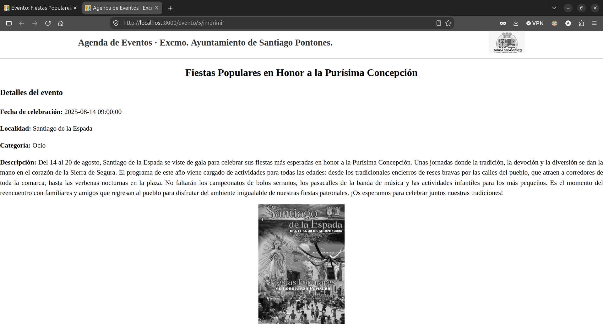
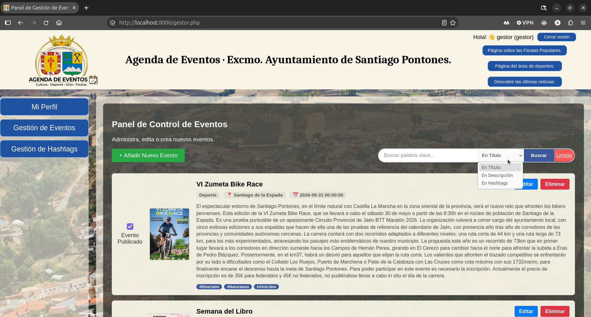

# Agenda de eventos - Ayuntamiento de Santiago-Pontones
  
     

	

 

## 1.- Descripción del proyecto.

**Agenda de Eventos del Ayuntamiento de Santiago-Pontones** es un portal web para publicar y consultar eventos, actividades culturales, noticias y otros contenidos de interés local.

El proyecto se desarrolló para la asignatura **Sistemas de Información Basados en Web (SIBW)** del grado en Ingeniería Informática durante el curso 2025/2026, en la Universidad de Granada. 

El proyecto fue evolucionando desde una interfaz estática hasta una aplicación web completa con backend propio, base de datos relacional, gestión de contenidos y peticiones asíncronas.

Su objetivo es ofrecer una experiencia de consulta de cara al público, y, al mismo tiempo, un espacio de administración adaptado a los permisos de cada usuario encargado de la gestión de contenidos.

## 2.- Tecnologías utilizadas.

Puesto que se trata de un proyecto académico, el desarrollo se ha realizado sin el uso de frameworks de desarrollo web, con el fin de comprender y aplicar los estándares web nativos y las buenas prácticas de programación. Las tecnologías empleadas son:

- **Frontend:** HTML5 semántico, CSS3 puro (implementando Flexbox y CSS Grid, sin utilizar librerías como *Bootstrap*), y JavaScript vanilla (para la lógica del cliente: manipulación del DOM, validación de formularios mediante expresiones regulares, etc).
- **Backend:** PHP 8.3 ejecutado sobre Apache.
- **Vistas (Renderizado):** Motor de plantillas **Twig** para separar vistas y controladores.
- **Base de datos:** MySQL 8 y PDO con sentencias preparadas.
- **Comunicación asíncrona:** Fetch API y endpoints PHP que responden en JSON.
- **Entorno de despliegue:** Sistema contenerizado con **Docker y Docker Compose** (stack LAMP: Linux, Apache, MySQL, PHP) y configuración de servidor Apache mediante `.htaccess` para URLs amigables.
- **Codificación:** `utf8mb4` con reglas de ordenación en español.

## 3.- Arquitectura del sistema

El proyecto sigue una arquitectura **Modelo-Vista-Controlador (MVC)** desacoplada, garantizando la separación de responsabilidades y la mantenibilidad del código:

### 3.1.- Modelo (Acceso a datos).

- `bd.php` centraliza las consultas a la base de datos MySQL mediante PDO. Impelemnta el patrón de desarrollo de software **Singleton** para garantizar que solo exista una instancia de conexión a la base de datos durante el ciclo de vida de una misma petición HTTP.
- Utiiza **sentencias preparadas* en todas las consultas para prevenir ataques de inyección SQL.

### 3.2.- Vista.

- **Plantillas de Twig** en el directorio `www/templates/`. La interfaz utiliza un sistema de herencia de plantillas con Twig. Existe una plantilla base llamada `padre.html` que define la estructura común de todas las páginas (cabecera, menú lateral, estructura Grid y pie de página). de la cual heredan las demás vsitas específicas.

- **Tratamiento seguro de variables:** Los datos dinámicos obtenidos desde el backend se transmiten a la interfaz mediante atributos `data-* en etiquetas HTML o mediante JSON seguro, evitando la inyección de código mediante bloques.

### 3.3.- Controlador.

- **Los controladores principales (`index.php`, `eventos.php`, `usuarios.php`):** Procesan las peticiones `GET/POST`, gestionan la lógica de negocio, interactúan con la capa de modelo (`bd.php`) y renderizan la plantilla Twig correspondiente pasándole los parámetros requeridos.

- **Endpoints para peticiones AJAX:** Serían los archivos (`api_*.php`) que procesan las peticiones asíncronas desde el cliente (`HTTP POST/GET`), y devuelven respuestas en formato `JSON`. Estos endpoints permiten la actualización de contenidos sin recargar la página, mejorando la experiencia de usuario. Son utilizados, por ejemplo, en el incio/cierre de sesión, el buscador dinamico de eventos o la gestión de visibilidad de los eventos, entre otras.

Mediante el archivo `.htaccess` en la raíz del servidor Apache, se enmascaran las URLs dinámicas por **direcciones URL amigables** (ej. `/evento/ID` en lugar de `/evento.php?id=ID`), manteniendo la estética y el enrutamiento limpio.

Podemos ver un diagrama de arquitectura del sistema que muestra la relación descrita:

También se puede consultar en el siguiente enlace:
[Diagrama de arquitectura](docs/diseno/diagrama-de-arquitectura.png).

## 4.- Funcionalidades y sistema de roles.

La aplicación permite consultar y gestionar la agenda de eventos del Ayuntamiento de Santiago-Pontones. Su funcionamiento se adapta al tipo de usuario que accede al sistema, dividiéndose en una zona pública para los visitantes y un panel de administración restringido para los usuarios autorizados. 

### 4.1.- Funcionalidades principales.

#### Consulta de eventos.

La portada muestra los eventos publicados en forma de tarjetas, incluyendo su título, imagen principal, categoría, localidad y fecha de realización; ordenados de forma cronológica (siendo el primer evento el más próximo en el tiempo). *Solo los eventos marcados como publicados aparecen en la portada*.

Cada evento tiene su propia página de detalle, donde se muestra: 
- Título, fecha y hora de celebración. 

- Localidad y categoría.

- Descripción completa.

- Hashtags asociados.

- Cartel principal.

- Galería de imágenes.

- Comentarios relacionados.

- Enlaces para compartir o acceder a la versión imprimible del evento.

Podemos ver un ejemplo de la página de detalle de un evento:

	

El **panel de comentarios** se despliega pasando el ratón por el borde derecho de la pantalla y permite a los visitantes dejar su opinión sobre el evento, siempre que se encuentren logueados en el sistema.

    

Si pulsamos el botón de la impresora que se muestra en la barra superior de la página del evento, nos mostrará la **versión imprimible del evento**, con un diseño adaptado a la impresión en papel.

    

#### Búsqueda dinámica de eventos.

La portada incluye un **buscador** que permite localizar eventos mientras el usuario escribe. Los resultados se solicitan mediante AJAX y aparecen dinámicamente sin necesidad de recargar la página.

    

En el panel de gestión de eventos (solamente accesible para gestores y administradores), también existe un **buscador dinámico** que permite localizar eventos por buscando palabras clave en el título, descripción o hashtags.

    

#### Gestión de usuarios.

## 5.- Modelo de datos y seguridad.

## 6.- Requisitos, configuración y despliegue (Docker).

## 7.- Guía de uso y ejemplos.

## 8.- Autoría y licencia.